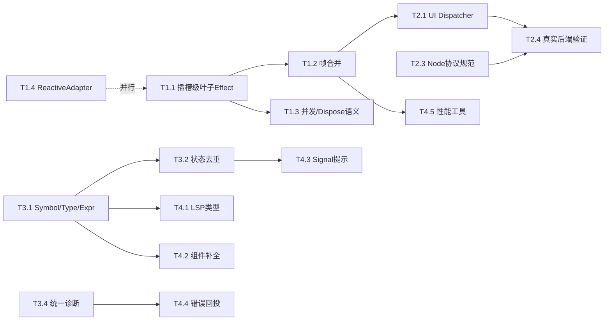

# 架构评审行动清单（基于 8.0/10 设计评审）

> 本文档把《8.0 _ 10》架构评审的问题与建议，转成可执行、带依赖关系的任务清单。
> 每条结论都对照真实代码核实过，避免把"报告说的"直接当成"代码现状"。

## 0. 基线与核实说明

| 项 | 值 |
| --- | --- |
| 评审引用的最新提交 | `e8bbd7a`（2026-11-23 01:09 UTC） |
| 本清单核对的代码基线 | `cb02f59`（评审后又合入 B2/B3/B11 推断修复与 C 组诊断） |
| 评审性质 | 设计潜力评估（8.0/10），非生产可用性认证；作者已声明未跑全量测试 |
| 核实方法 | 逐条比对了 `runtime/app/app.go`、`runtime/scene/scene.go`、`runtime/signal/signal.go`、`pkg/compiler/*`、现有 docs |

**评审已过时的两点**：

1. 报告说"最新提交 e8bbd7a，编译器仍在密集修正"，基线之后已补：B2 嵌套 For 元素类型、B3 getter 变量自动调用、B11 零 props 组件、C2 signal 切片元素深写诊断。报告"不支持语法应明确报错"的方向，现已扩展到 C 组。
2. 报告问题 2 说 scene 用 `Computation` 类型别名解耦——现状如此，且 scene 内部已进一步细分出 `BindStructural` / `bindLeaves` / `bindCtx` 三套接线路径，比报告描述的更细。

## 1. 五个问题核实对照

| # | 报告问题 | 优先级 | 代码核实 | 已有基础（不要重复造） |
| --- | --- | --- | --- | --- |
| 1 | App 聚合 Effect，未达插槽级细粒度 | P1 | ✅ 属实：`bindReactive()` 用一个 `signal.Effect` 调 `Instance.Update()` 递归遍历全树 | scene 已有 `BindReactive`（每叶一 effect）、`bindLeaves`、`SetPart(slot,...)`、`BindStructural`。**切换的是 app 的接线策略，不是从零实现插槽 effect** |
| 2 | Signal 与 Scene 职责耦合 | P1 | ✅ 属实：scene 需注入 `effect func(func()) Computation` | 已用 `Computation` 类型别名统一签名；抽象 `ReactiveAdapter` 属锦上添花，单实现阶段收益低 |
| 3 | 编译器语义分析需统一 | P1 | ✅ 属实：`jsxSceneCtx` 同时持 `bindings`/`sigs`/`sigTypes`/`signalFields` 多源 | 已有统一 Bindings、表达式 AST、`Pos.Offset` 绑定身份；"Symbol/Type/Expression 三概念"是下一步收敛方向 |
| 4 | GUI 调度不完善，Draw 可能非 UI 线程 | P1 | ✅ 属实：`a.Draw()` 在 effect 回调里同步执行，全仓无 dispatcher/scheduler | `Batch` 已合并同轮写入为一帧；缺的是"帧请求 → UI 线程"这一步 |
| 5 | Node 协议宽泛 `Props map[string]any` | P2 | ✅ 属实：`Node` 结构如报告所述，`Layout any` 挂载点已留白 | `ID`（跨帧稳定）、`Layout`、`SyntheticEvent` 已是后端扩展机制的基础 |
| 债 | goid 依赖 `runtime.Stack` | P2 | ✅ 属实：`signal.go` 仍抓栈取 goid | 已有 `activeObservers` 原子计数，普通读走无锁快路径跳过 goid（~2ns）；只需隔离模块，不必重写 |

## 2. 任务清单

优先级：**P1** = 报告认定的长期维护关键；**P2** = 重要但可后置；**P0** = 启动前置（如基线锁定）。

### 阶段一：确定响应式更新模型（报告四阶段之"第一阶段"）

| ID | 任务 | 优先级 | 依赖 | 已有基础 | 验收标准 |
| --- | --- | --- | --- | --- | --- |
| T1.1 | App 叶子接线从"聚合 Effect + 全树 Update"切换为"每插槽 Effect + SetPart"，与结构接线分工 | P1 | — | `BindReactive`/`bindLeaves`/`SetPart`、`bindCtx` 已实现 | 单 signal 变化只重求值依赖它的 getter；`app_test.go` 新增"只写 1 个节点、其余 getter 未求值"断言（如计数器探针） |
| T1.2 | 帧合并：多个 signal 同帧变化只 Draw 一次，保留"一帧一致性" | P1 | T1.1 | `Batch` 已合并写入为一帧 | 批次内改 N 个 signal，`countingWindow.DrawCount` 只 +1；现有 `TestBatchAddWithIfDrawsOneFrame` 扩展覆盖叶子路径 |
| T1.3 | 明确 `Batch` / `Computation.Dispose` 并发语义，补生命周期并发测试 | P1 | T1.1 | Owner/Cleanup 压力测试已有 | 新增"Effect 运行中被 Dispose""后台 goroutine 并发写 + Batch"测试，无 panic、无泄漏（`-race`） |
| T1.4 | Signal↔Scene 解耦为 `ReactiveAdapter{Effect func(func()) Computation}` | P2 | —（可与 T1.1 并行） | `Computation` 类型别名已消除签名硬依赖 | scene 包不再 import signal 包（或仅 test）；替换注入实现可跑通现有 scene 测试 |

### 阶段二：完善 GUI Runtime（"第二阶段"）

| ID | 任务 | 优先级 | 依赖 | 已有基础 | 验收标准 |
| --- | --- | --- | --- | --- | --- |
| T2.1 | App 层 UI Dispatcher：帧请求入队，UI 线程统一 Draw；Signal 回调不直接碰窗口 | P1 | T1.2 | `Batch` 帧合并已就绪 | 后台 goroutine 写 signal 不触发非 UI 线程 Draw（用记录线程 id 的 mock window 验证） |
| T2.2 | Draw/Update 错误显式报告，替换 `_ = a.Draw()` 忽略 | P2 | — | `Window.Draw` 已返回 error | `Draw` 失败可被 `App` 查询或回调上报；新增错误注入测试 |
| T2.3 | Node 属性协议规范：通用/布局/文本/事件/后端扩展五类字段的类型与语义 | P2 | — | `ID`/`Layout`/`SyntheticEvent` 已是扩展基础 | 产出 `docs/node-protocol.md`，明确 px 与百分比、class/style 类型、文本字体行高对齐 |
| T2.4 | 用真实 GUI 后端（Skia 分支）验证协议与调度 | P2 | T2.1, T2.3 | `feat/skia-backend` 已移植 issue#1 根因修复、已去协议层 workaround | 组件库 demo 跑通，blink 翻转无结构动作（回归既有 `dynchildren_test` 语义） |

### 阶段三：稳定编译器（"第三阶段"）

| ID | 任务 | 优先级 | 依赖 | 已有基础 | 验收标准 |
| --- | --- | --- | --- | --- | --- |
| T3.1 | 明确并收敛 `Symbol`/`Type`/`Expression` 三概念，Transform 统一消费 | P1 | — | 统一 Bindings、表达式 AST、`Pos.Offset` | 至少 2 个 Transform 不再各自扫 token 判断变量身份 |
| T3.2 | `jsxSceneCtx` 状态去重，消除 `bindings`/`sigs`/`sigTypes`/`signalFields` 冗余来源 | P2 | T3.1 | 缺陷清单 B1/B2 已暴露多源推断不一致 | JSX 场景不再独立维护 signal 识别规则；B1/B2 回归测试全绿 |
| T3.3 | 建立语法特性交互测试矩阵（Signal×JSX×For×Lambda×对象字面量） | P1 | — | 已有批次 1-8 的分散回归测试 | 矩阵覆盖缺陷清单 A/B/C 全部条目，CI 可跑 |
| T3.4 | 统一诊断与错误恢复机制 | P2 | T3.1 | A2/A3/B6/B9/A6/C2 已改为带坐标诊断 | 所有 `GXDiagnostic` 走统一格式与回投，新增一条诊断的样板清晰 |

### 阶段四：完善开发体验（"第四阶段"）

| ID | 任务 | 优先级 | 依赖 | 验收标准 |
| --- | --- | --- | --- | --- |
| T4.1 | LSP 类型提示 | P2 | T3.1 | hover 显示 GX 推导类型 |
| T4.2 | JSX 组件补全 | P2 | T3.1 | 输入 `<` 列出组件与 props |
| T4.3 | Signal 类型提示 | P2 | T3.2 | `signal` 变量 hover 显示 `Signal[T]` |
| T4.4 | 编译错误精确回投 | P2 | T3.4 | go build 错误映射到 .gx 正确行列（已有 project 模式基础） |
| T4.5 | 调试与性能分析工具 | P2 | T1.2 | 可观测 getter 重求值次数、写入节点数 |

### 贯穿技术债

| ID | 任务 | 优先级 | 依赖 | 验收标准 |
| --- | --- | --- | --- | --- |
| TX.1 | goid 上下文隔离为独立模块（不重写 Signal） | P2 | — | `runtime/signal` 中 goid 相关代码集中到一个文件/包，替换实现不动核心逻辑；快路径性能不回退 |

## 3. 依赖关系图

## 4. 建议执行顺序

评审作者明确："如果只能选一个下一步重点，选 App 聚合 Effect 与插槽级 Effect 的统一。"据此：

1. **第一步 T1.1 + T1.2**：插槽级切换与帧合并必须一起做——只切前者会导致多帧重绘，只做后者无意义。这是报告认定的"决定 Gox 最终形态"的一步。
2. **第二步 T2.1**：有了帧合并，UI Dispatcher 才有干净的接入点；这一步解决报告问题 4 的线程安全边界。
3. **第三步 T3.1 + T3.3**：编译器语义收敛与交互测试矩阵，防止后续重构引入回归（缺陷清单 8 批已证明这一区域脆弱）。
4. **其后按依赖推进**：T1.3/T1.4/T2.2/T3.4/TX.1 为低耦合项，可穿插；T4.x 开发体验放到语义稳定后。

## 5. 风险提示

- **T1.1 的陷阱**：切换接线策略时，务必保留组件实例保稳（`slot.stableChildComp()`，issue#1 根因修复）。若为叶子建 effect 的递归逻辑重新求值组件 getter，会重现"组件子树整棵重建"。scene 里 `bindLeaves` 已经绕开了这点，照它的模式走。
- **T1.2 的权衡**：聚合模式的价值是"一帧内叶子状态一致"。纯插槽级 + Batch 后要验证帧一致性没有退化——不是简单删掉聚合 effect。
- **T2.1 的边界**：不要让 Signal Runtime 管理 GUI 线程；App 负责把响应式更新转成后端可安全消费的绘制任务。
- **报告未覆盖的既有成果**：issue#1 根因修复已在 main 与 `feat/skia-backend` 双分支落地；缺陷清单 A/B/C 组 8 批已全部修复并推送。这些是继续演进的稳定基线，不是待办。
