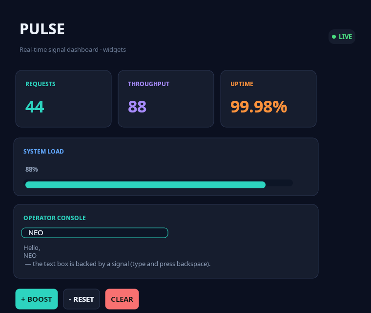

# Gox 桌面 Demo —— PULSE 实时数据看板

这是从 **GX 源码 → Go 编译 → Skia 真实窗口渲染 → 交互** 的端到端可运行 demo。
它把前面所有评审轮次里打磨的能力（signal 响应式、JSX 组件、事件、Skia 后端、
Yoga 3.x 布局、**后端预制控件库**、**真实键盘输入**）串成一个有审美的深色数据看板。



## 一句话运行

```bash
# 在有 X11 显示的 Linux 上（无显示可用 xvfb-run）：
xvfb-run -a go run .
```

- 深墨蓝背景铺满窗口，顶部品牌区 + LIVE 状态徽章。
- 三张圆角 KPI 卡片：`REQUESTS`（青，每 1.4s 自动 +1）、`THROUGHPUT`（紫，computed 派生）、`UPTIME`（橙）。
- `SYSTEM LOAD` 进度条宽度由 computed 实时驱动，随数值联动。
- **OPERATOR CONSOLE**：一个真实可输入的文本框，点击聚焦（青色边框 + 闪烁光标），
  键入/退格实时写回 signal，下方 `Hello, …` 同步更新。
- 点击 `+ BOOST` / `- RESET` 即时增减 10，`CLEAR` 清空输入框；图表与卡片同步刷新。
- `ESC` 或 `Ctrl+Q` 退出。

## 后端预制控件库（widgets）

**所有 KPI 卡片、徽章、进度条、输入框、按钮都不是业务手写的样式**——它们来自
skia 后端独立 module 里的预制组件库 `github.com/robertpanvip/gox-backend-skia/widgets`。
业务 JSX 只描述语义，外观（配色/圆角/描边/间距/字号）全部预制在后端：

```jsx
import widgets "github.com/robertpanvip/gox-backend-skia/widgets"

<widgets.row gap="14">
  <widgets.card title="REQUESTS" tone="cyan" width="196">…</widgets.card>
  <widgets.card title="THROUGHPUT" tone="purple" width="196">…</widgets.card>
</widgets.row>
<widgets.badge label="LIVE" tone="green" dot/>
<widgets.progress value={loadPct} tone="cyan" label="…"/>
<widgets.button label="+ BOOST" variant="primary" onClick={…}/>
```

| 控件 | 关键 props | 说明 |
|---|---|---|
| `widgets.button` | `label` `variant`(primary/secondary/ghost/danger) `width` `onClick` | 预制按钮，配色随 variant |
| `widgets.input` | `id` `value` `placeholder` `onInput` `width` `tone` | 受控输入框，真实键盘输入（见下） |
| `widgets.card` | `title` `tone` `width` `padding` `children` | 圆角描边卡片 + 强调色标题 |
| `widgets.badge` | `label` `tone` `dot` | 小徽章，可选前置圆点 |
| `widgets.progress` | `value`(0-100) `width` `tone` `label` | 进度条，宽度钳制到 0-100% |
| `widgets.divider` | `width` | 分隔线 |
| `widgets.row` / `widgets.col` | `gap` `align` `justify` `width` `children` | Flex 容器 |

组件库**只依赖 host 的 `gxscene`/`signal`**，不依赖 skia 绘制代码——它产出的是
「带样式属性的场景树」，任何理解这些 additive 属性的后端都能画。因此把控件库放进
后端 module **不影响"后端可剥离、核心零改动"结论**：`runtime/`、`pkg/`、`cmd/` 一行未改。

GX 侧用小写 `widgets.button` 书写，编译器按 Go 来源约定还原为 `widgets.Button` 导出名。

### 真实键盘输入如何闭环

Input 采用受控组件契约：`value` 是当前文本的值 getter，`onInput` 是回写回调。
signal 作为 JSX 属性会被编译器自动解引用成值 getter（`value={name}` → `func() any{return name()}`）。

```jsx
<widgets.input id="operator" value={name}
  onInput={widgets.bindInput(func(s string) { name = s })}/>
```

- `widgets.bindInput(fn)` 把 `func(string)` 包装成 `onInput` Handler，新文本从
  `EventContext.Synthetic.Data["text"]` 取出后回调 `fn` → 写 signal → 重绘 → 显示更新。
- **焦点**：点击命中的若是输入框（含其文字子节点），`widgets.Focus(node)` 写入全局焦点
  id（signal）；边框/光标 getter 读它 → 自动重绘高亮。用业务传入的稳定 `id` 作标识，
  因为嵌在动态 `children` 插槽里的组件会被反复重建，随机 token 会失效。
- **键盘**：GLFW `SetCharCallback`（可打印字符）和 `KeyCallback`（Backspace）经
  `widgets.InputChar/InputBackspace` 读焦点节点当前 value、算新文本、派发 `onInput`。
- **光标闪烁**：包级 blink signal 由后台 goroutine 每 530ms 翻转，光标 getter 读它 → 闪烁。
- **中文 / CJK 输入**：GLFW `CharCallback` 收到的是 Unicode rune，输入法上屏的汉字会作为
  rune 经 `InputChar` 按字节追加、退格按 rune 删除（不会切出半个 UTF-8 字节）。渲染侧
  `backend/skia/font.go` 为每个字符检测字形覆盖（`UnicharToGlyph`）：主字体 `sans-serif`
  缺中文时按 `cjkFamilies` 候选列表（Noto Sans CJK SC / 苹方 / 微软雅黑 …）选第一个能覆盖
  的字体，文本按字体分段绘制；measure 与绘制共用同一决策，混排宽度与落笔一致、不溢出。
  注：GLFW 不处理输入法「组合中」的预编辑串，候选词 UI 由系统 IME 提供，仅最终上屏字进入输入框。

GUI 适配层（`glwindow.go`）只需在命中/键盘回调里调 `widgets.Focus / InputChar /
InputBackspace`，无需理解控件内部结构和样式。

## 完整链路（这个 demo 证明了什么）

| 层 | 组件 | 职责 |
|---|---|---|
| 业务 | `app.gx` | GX 源码：signal、`Signal.computed` 派生、JSX + 预制控件、`onInput`/`onClick` handler、goroutine 实时流 |
| 编译 | `gox build` | 把 `app.gx` 编译为 `main.go`（signal.New / gxscene.Render / gxapp.OpenWith / widgets.* 调用） |
| 响应式 host | `runtime/app` + `runtime/scene` + `runtime/signal` | signal 写入 → 精确更新场景树 → 自动触发窗口重绘（**零改动**） |
| 渲染协议 | `backend/skia`（独立 module） | `skia.PaintTo` 场景树遍历 + Yoga Flexbox + 样式解析 + Skia 绘制；`widgets` 预制控件库 |
| GUI 适配 | `glwindow.go` | `gxapp.Window`：GLFW 窗口 + Skia GL surface + 事件循环 + 命中/焦点/键盘派发 |

## Flex 布局（Yoga 3.x 引擎）

布局由 **Yoga 3.x**（`github.com/ahati/yoga-go-binding`，C++20 `libyogacore.a` 的 Go 绑定，
Meta 官方 Yoga 引擎的完整 C API 封装）完成，完全在 skia 后端内部，**核心运行时零感知**。
JSX 属性原样进入 `Node.Props`，后端解释语义：

| 属性 | 取值 | 说明 |
|---|---|---|
| `flex-direction` | `row` / `row-reverse` / `column`（默认）/ `column-reverse` | 主轴方向 |
| `flex-wrap` | `nowrap`（默认）/ `wrap` / `wrap-reverse` | 换行 |
| `justify-content` | `flex-start` / `center` / `flex-end` / `space-between` / `space-around` / `space-evenly` | 主轴对齐 |
| `align-items` | `flex-start` / `center` / `flex-end` / `stretch`（默认）/ `baseline` | 交叉轴对齐 |
| `align-content` | `flex-start` / `center` / `flex-end` / `space-between` / `space-around` / `stretch` | 多行交叉轴对齐 |
| `gap` / `row-gap` / `column-gap` | 像素数（如 `12` / `"12px"`） | 统一 / 行 / 列间距（**原生支持**） |

> 升级说明：早期用 2017 年的纯 Go 移植 `kjk/flex`（无原生 gap、不支持换行，gap 靠
> margin 模拟）。现已换成 Yoga 3.x——原生 `gap`/`flex-wrap`/`space-evenly`/`align-content`
> 等完整能力。Yoga 返回相对父节点坐标，后端递归累加父偏移换成画布坐标。
>
> **组件透明性**：`NodeFragment`（组件槽 / 条件分支 / keyed 列表的 `#frag`）在 Yoga 里
> 用 `display: contents` 语义——自身不产生布局盒子，children 直接参与父容器 flex 排版。
> 否则预制控件库里 `Row > Card` 的多层组件包装会让横排退化成竖排
> （`layout_test.go::TestFragmentTransparentInRow` 防回归）。
>
> 代价：引入 CGO 依赖（预编译 `libyogacore.a` + `-lstdc++`），与已有 Skia CGO 无冲突，
> 仍完全收在 skia 子模块内。

## 视觉样式（圆角 / 描边 / 样式继承）

看板的圆角卡片、描边、协调配色全部由后端 additive 属性实现，核心零改动：

| 属性 | 说明 |
|---|---|
| `border-radius` | 圆角半径，走 Skia `DrawRoundRect` + 抗锯齿，自动钳制到短边一半 |
| `border` + `border-width` | 描边颜色与宽度，走 Skia stroke 样式 |

文本节点 Props 通常为空，`color`/`font-size`/`weight` 写在父元素上由 painter 沿祖先链继承，
且 Yoga measure 用同样的字号，保证布局尺寸与实际绘制一致（`TestTextStyleInheritance` 防回归）。

**关键解耦结论**：整个真实 GUI 适配层（`glwindow.go`）只依赖 host 的 `gxapp.Window` 接口
与 skia 后端的 `skia.PaintTo` + `widgets` 控件库 API。host 的 `runtime/`、`pkg/`、`cmd/`
**一行都没改**——这正是"后端可剥离、依赖单向"结论的实证。

## 从 GX 重新生成 main.go

```bash
# 仓库根：构建 gox CLI
cd ../.. && go build -o /tmp/gox ./cmd/gox
cd examples/desktop-demo
/tmp/gox build app.gx -o main.go
go run .
```

> 注意：当前 GX 编译器对「JSX 元素跨行缩进」有一个边界缺陷（跨行时会多生成一个闭合括号
> 导致生成代码语法错误）。本 demo 的根视图写成**紧凑单行**规避了它。这也是本 demo
> 顺带暴露的一个待修编译器问题。

## 依赖与构建说明

- 本目录是**独立 Go module** `gox-desktop-demo`，通过根 `go.work` 与 host、skia 后端联调。
- 依赖 host（`/workspace/gox`）、可剥离 skia 后端（`/workspace/gox/backend/skia`）及其
  `widgets` 子包，均为本地 `replace`。
- 链接依赖：go-skia 预编译静态库（`--start-group` 修复顺序）+ GLFW 的 X11 开发库。
  沙箱里只有运行时 `.so.1`，仓库根的 `.demolibs/` 提供对应 `.so` 开发软链，由
  `linkflags.go` 通过 `-L` 引入。常规 Linux 桌面装 `libglfw3-dev` + X11 dev 后无需此目录。

### 线程模型（真实 GUI 的关键）

GL context 只在主线程 `current`，而 signal effect 会在**写入方 goroutine**里回调
`Window.Draw()`。因此 `glWindow.Draw()` 只加锁记录场景树并置 dirty，真正的 GL 绘制由
主线程 `Run()` 事件循环里的 `paintNow()` 执行。键盘/焦点事件在主线程回调里派发，经
widgets 层写 signal 触发重绘，全程不跨线程碰 GL。

## 文件清单

- `app.gx` — GX 源码（应用逻辑，使用后端预制控件）
- `main.go` — `gox build` 生成的 Go 产物
- `glwindow.go` — 真实 GLFW/Skia 窗口后端 + 事件循环 + 命中/焦点/键盘派发
- `linkflags.go` — 静态库链接顺序 + X11 开发库路径
- `go.mod` / `go.sum` — 独立 module 依赖
- `preview.png` — 运行效果截图（含聚焦输入框与实时输入态）
